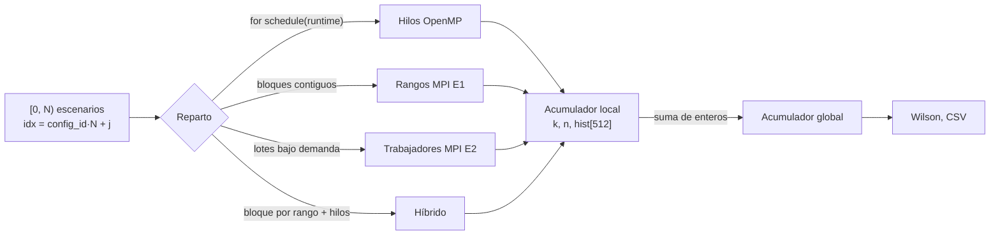
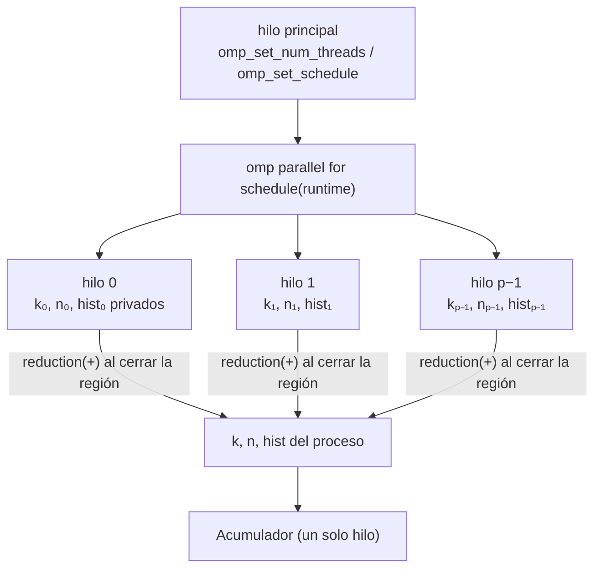
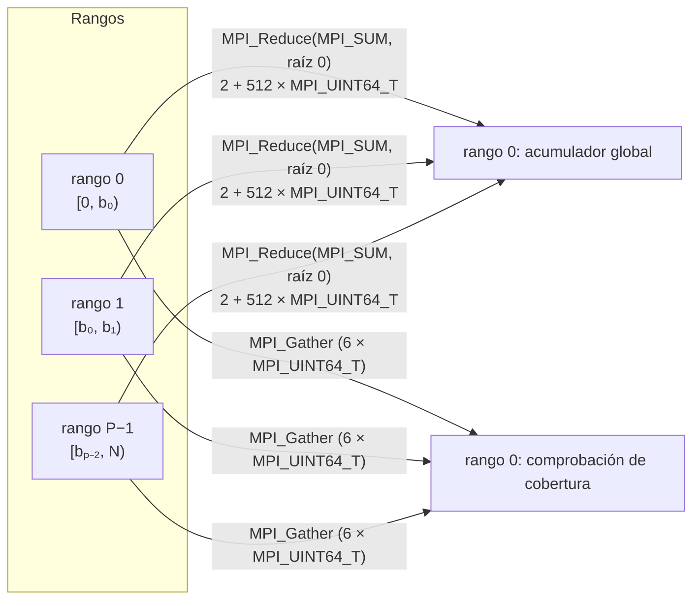
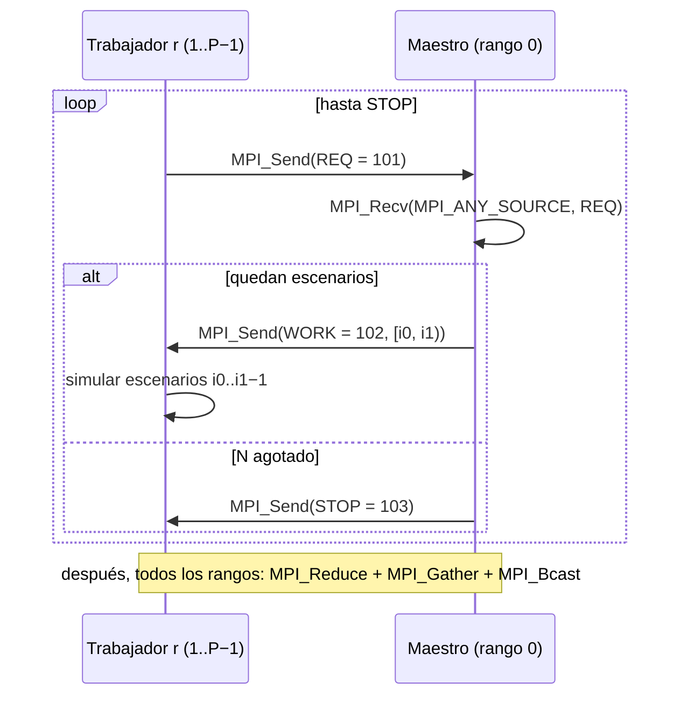
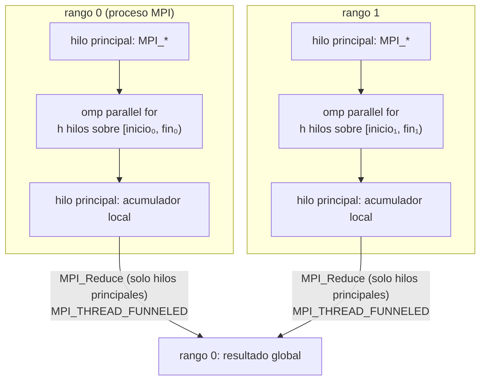

# Arquitectura paralela del simulador (T37)

**Responsable:** Ashley (R3) · **Alcance:** secuencial, OpenMP, MPI E1 (estático), MPI E2 (dinámico) e híbrido MPI + OpenMP. CUDA es una extensión en desarrollo (`docs/decision-cuda.md`).

Este documento explica cómo se reparte el trabajo y por qué todos los backends dan el mismo resultado. Cada afirmación remite al código con la forma `ruta:línea`, de modo que pueda comprobarse con `rg -n` sobre el repositorio.

## 1. Descomposición de datos

El trabajo de una configuración son N escenarios independientes (temporadas de D días). El escenario local `j` (0 ≤ j < N) se convierte en un índice global estable `idx = config_id · N + j`:

- secuencial: `src/backends/serial/main.cpp:17` y `:21`;
- OpenMP: `src/backends/openmp/ejecutor.cpp:60` y `:68`;
- MPI E1/E2: `src/backends/mpi/comun.cpp:35-36`.

`simular_escenario(p, clave, idx)` depende solo de los parámetros, la clave y el índice. No usa estado compartido (`include/simulacion.hpp:3-6`, `src/core/balance_hidrico.cpp:12-24`). Por eso cualquier reparto de los índices entre hilos o procesos procesa exactamente los mismos escenarios.

Cada escenario aporta tres cantidades enteras a un `Acumulador`: `k` (escenarios con inundación), `n` (escenarios simulados) y un histograma de 512 clases del máximo acumulado (`include/resultados.hpp:13-21`, `include/simulacion.hpp:13`). La reducción entre hilos y procesos es una suma de enteros sin signo de 64 bits.

## 2. Generador Philox basado en contador

El generador es Philox4x32-10 (`src/core/philox_rng.cpp:26-37`), una función pura `philox(contador, clave)` sin estado interno. Coincide con los vectores de prueba de Random123 (`include/simulacion.hpp:36`, `tests/smoke`).

- **Clave:** 64 bits obtenidos de la semilla global y de `config_id` mediante `derivar_clave`, con dos pasadas de SplitMix64 (`src/core/philox_rng.cpp:39-42`). No depende de hilos ni de procesos.
- **Contador:** `{idx_bajo, idx_alto, día, sub}` (`src/core/modelo_lluvia.cpp:12-16`). `sub = 0` decide la ocurrencia de lluvia (`:19-23`). `sub = 1, 2, …` son los intentos del muestreo gamma de Marsaglia–Tsang (`:34-35`).

Cada número aleatorio queda determinado por `(semilla, config_id, idx, día, sub)`. No existe un flujo secuencial que haya que avanzar o partir entre hilos. Esto, junto con la descomposición de §1, explica que los resultados sean idénticos bit a bit en todos los backends:

1. Cada escenario consume los mismos números aleatorios, lo procese el hilo o el proceso que sea.
2. Los cálculos en punto flotante (`amax`, Lindley) ocurren dentro de un escenario y en el mismo orden (`src/core/balance_hidrico.cpp:16-22`). Ningún valor de punto flotante se reduce entre hilos ni procesos.
3. Lo que sí se reduce (`k`, `n`, `hist`) son enteros. La suma de enteros es asociativa y conmutativa, así que el orden de la reducción no cambia el resultado.

La prueba V1 compara `k`, `n` y el histograma completo con la referencia secuencial (`include/resultados.hpp:20`; MPI: `src/backends/mpi/comun.cpp:130-136`; OpenMP: comparación por corrida en `scripts/bench/medir_openmp.py:164-165`).

## 3. OpenMP

`ejecutar_openmp` (`src/backends/openmp/ejecutor.cpp:55-79`) procesa el intervalo local `[j0, j1)`:

- **Hilos:** `omp_set_num_threads(hilos)` cuando `hilos > 0`. Con 0 se respeta `OMP_NUM_THREADS` (`:57`, `include/openmp.hpp:16`). El tamaño real del equipo se lee después con `hilos_efectivos()` (`:45-53`) y se registra en el CSV (`src/backends/openmp/main.cpp:26`).
- **Schedule:** el bucle usa `schedule(runtime)` (`:66`). El tipo y el tamaño de bloque se fijan con `omp_set_schedule` a partir de `--schedule static|dynamic|guided[:chunk]` (`:15-30`, `:58`). Si `--schedule` está vacío se respeta `OMP_SCHEDULE`. El schedule efectivo se lee con `omp_get_schedule` (`:34-43`).
- **Reducción:** `reduction(+ : k, n) reduction(+ : hist[:NBINS])` (`:66`). Cada hilo tiene copias privadas de `k`, `n` y de un histograma de 512 clases (4 KB), y OpenMP las suma al cerrar la región. El bucle no escribe en memoria compartida (`:64-72`), por lo que no hay carreras. V5 lo comprueba con Archer (`results/evidencia/t17_v5_archer.log`).

## 4. MPI

Los tres ejecutables MPI comparten `ejecutar_mpi` (`src/backends/mpi/comun.cpp:39-159`) y solo cambian el esquema de reparto (`src/backends/mpi/main_estatico.cpp:5`, `src/backends/hybrid/main.cpp:5`). El flujo común es:

1. `MPI_Init_thread` pidiendo `MPI_THREAD_FUNNELED` (`:41`).
2. `MPI_Barrier` y luego `MPI_Wtime` para tomar el tiempo inicial (`:72-73`).
3. Cada rango ejecuta el esquema y llena su acumulador local (`:74-75`).
4. Una sola colectiva `MPI_Reduce` suma `k`, `n` y las 512 clases en el rango 0, empaquetadas en un vector de `2 + 512` valores `MPI_UINT64_T` (`:78-82`).
5. `MPI_Gather` envía al rango 0 el resumen de cada rango (inicio, fin, bloques, `n_local`, coherencia, hilos) para el log `[verif]` y la comprobación de cobertura (`:85-87`, `:104-122`).
6. El rango 0 verifica V3 (`suma_n = N`, suma del histograma igual a `n`) y, con `--verificar`, también V1 (`:123-136`).
7. `MPI_Bcast` comunica el código de salida a todos los rangos y se llama a `MPI_Finalize` (`:156-157`).

### 4.1 E1: partición estática por bloques

`intervalo_estatico(n, rango, procesos)` asigna a cada rango un intervalo contiguo `[inicio, fin)` de tamaño `⌊N/P⌋` o `⌊N/P⌋ + 1`. Los primeros `N mod P` rangos reciben un escenario más, sin solapes ni huecos (`src/backends/mpi/estatico.cpp:6-14`). Cada rango recorre su intervalo de forma secuencial (`:21-22`) y la reducción la hace `ejecutar_mpi` con `MPI_Reduce`. Durante el cómputo no hay mensajes punto a punto.

### 4.2 E2: maestro–trabajador dinámico (REQ / WORK / STOP)

Con P > 1 procesos, el rango 0 actúa solo como maestro y reparte trabajo sin simular escenarios. Los rangos 1 … P−1 son trabajadores (`src/backends/mpi/dinamico.cpp:72-88`). Con P = 1, el rango 0 procesa todo localmente (`:78-80`). Cada etiqueta identifica un tipo de mensaje (`include/mpi_dinamico.hpp:9-11`):

| Etiqueta | Valor | Sentido | Contenido |
| --- | --- | --- | --- |
| `ETIQUETA_REQ` | 101 | trabajador → maestro | 1 × `MPI_UINT64_T` sin significado (solicitud) |
| `ETIQUETA_WORK` | 102 | maestro → trabajador | 2 × `MPI_UINT64_T`: rango `[i0, i1)` |
| `ETIQUETA_STOP` | 103 | maestro → trabajador | 2 × `MPI_UINT64_T` vacíos; uno por trabajador |

- **Maestro** (`:28-53`): recibe solicitudes con `MPI_Recv(…, MPI_ANY_SOURCE, ETIQUETA_REQ)` (`:37`). Mientras queden escenarios, responde al emisor (`st.MPI_SOURCE`) con un lote `[siguiente, min(N, siguiente + lote))` y la etiqueta WORK (`:39-43`). El lote vale 62 500 por defecto (`include/resultados.hpp:47`). Cuando no quedan escenarios, responde con STOP y descuenta un trabajador activo (`:45-47`). Al terminar comprueba que los lotes asignados cubren `[0, N)` sin solapes ni huecos (`:17-26`, `:51`).
- **Trabajador** (`:55-68`): envía una solicitud REQ (`:59`) y recibe la respuesta con `MPI_ANY_TAG` (`:62`). Termina si la etiqueta es STOP (`:63`); si no, procesa el lote (`:64`).

El reparto equilibra la carga de forma automática: un trabajador más rápido pide más lotes. Como cada escenario depende solo de su índice (§2), el resultado no cambia con el orden en que se asignan los lotes.

## 5. Híbrido MPI + OpenMP

`esquema_hibrido` (`src/backends/hybrid/hibrido.cpp:10-29`) combina los dos niveles. Entre procesos usa la misma partición de E1 (`:16`). Dentro de cada proceso llama a `ejecutar_openmp` sobre su intervalo con `cfg.hilos` hilos (`:19`). Los recursos totales son `procesos × hilos`, y el rango 0 los imprime en el log (`src/backends/mpi/comun.cpp:97-101`).

- **Nivel de hilos:** solo el hilo principal llama a MPI. Por eso basta con `MPI_THREAD_FUNNELED` (`include/hibrido.hpp:8-11`). `ejecutar_mpi` lo pide en `MPI_Init_thread` y aborta el híbrido con código 2 si el nivel concedido es menor (`src/backends/mpi/comun.cpp:41`, `:61-66`).
- **Fuera de las regiones paralelas:** todas las llamadas MPI (`MPI_Comm_rank`, `MPI_Comm_size`, `MPI_Reduce`, `MPI_Gather`, `MPI_Bcast`) ocurren antes o después de `ejecutar_openmp` (`src/backends/hybrid/hibrido.cpp:12-19`, `src/backends/mpi/comun.cpp:75-87`). Dentro de la región `omp parallel for` no hay llamadas MPI (`src/backends/openmp/ejecutor.cpp:66-72`).

## 6. Afinidad

- **OpenMP:** las mediciones fijan `OMP_PROC_BIND=close` y `OMP_PLACES=cores`, y retiran `OMP_NUM_THREADS` y `OMP_SCHEDULE` del entorno para que solo cuenten las banderas (`scripts/bench/medir_openmp.py:126-127`, `:142-145`). La afinidad usada se guarda en cada fila del CSV (`include/resultados.hpp:71`).
- **Híbrido con Open MPI:** por defecto, `mpirun` ancla cada proceso a un solo núcleo. Así, los `h` hilos OpenMP de ese proceso compartirían ese núcleo y no habría paralelismo real dentro del proceso. Por eso las pruebas del híbrido se lanzan con `--bind-to none` (`src/backends/hybrid/CMakeLists.txt:15-18`), con `OMP_PROC_BIND=close;OMP_PLACES=cores` (`:29`); esas pruebas solo verifican equivalencia. Para **medir**, `scripts/bench/medir_hibrido.py` usa `--bind-to none` con `OMP_PROC_BIND=false`: sin anclaje MPI todos los procesos ven la misma lista de lugares y `close` (o `spread`) colocaría los hilos de procesos distintos en los mismos núcleos, empezando por el hilo 0 de cada uno. La alternativa con `close` es `--map-by ppr:<procesos>:node:PE=<hilos>`, que reserva `hilos` núcleos distintos por proceso. La regla completa está en `docs/contratos.md` §6 (sección del híbrido).
- **Efecto medido:** en una medición exploratoria del híbrido en el equipo de referencia (contenedor `pp-g8`), el speedup fue 1,90 sin `--bind-to none` y 7,13 con él. El CSV de esa corrida todavía no está versionado. La cifra se sustituirá por la matriz T27 (`results/bench/hibrido.csv`) cuando se mida.
- **Registro:** el rango 0 escribe `OMP_PROC_BIND` y `OMP_PLACES` efectivos en el log `[verif]` del híbrido (`src/backends/mpi/comun.cpp:100-101`).

## 7. Llamadas MPI usadas

Todas las llamadas se hacen desde el hilo principal de cada proceso.

| Llamada | Archivo:línea | Quién | Propósito |
| --- | --- | --- | --- |
| `MPI_Init_thread(…, MPI_THREAD_FUNNELED, &provisto)` | `src/backends/mpi/comun.cpp:41` | todos | Inicializa MPI y obtiene el nivel de hilos concedido. |
| `MPI_Comm_rank` | `src/backends/mpi/comun.cpp:43`, `src/backends/mpi/estatico.cpp:18`, `src/backends/mpi/dinamico.cpp:74`, `src/backends/hybrid/hibrido.cpp:13` | todos | Rango propio. |
| `MPI_Comm_size` | `src/backends/mpi/comun.cpp:44`, `src/backends/mpi/estatico.cpp:19`, `src/backends/mpi/dinamico.cpp:75`, `src/backends/hybrid/hibrido.cpp:14` | todos | Número de procesos P. |
| `MPI_Barrier(MPI_COMM_WORLD)` | `src/backends/mpi/comun.cpp:72` | todos | Sincroniza antes de medir. |
| `MPI_Wtime` | `src/backends/mpi/comun.cpp:73`, `:83` | todos (se publica el del rango 0) | Tiempo de pared desde la barrera hasta el final de la reducción. |
| `MPI_Recv(…, MPI_ANY_SOURCE, ETIQUETA_REQ)` | `src/backends/mpi/dinamico.cpp:37` | maestro E2 | Recibe una solicitud de cualquier trabajador. |
| `MPI_Send(…, ETIQUETA_WORK)` | `src/backends/mpi/dinamico.cpp:41` | maestro E2 | Envía el lote `[i0, i1)`. |
| `MPI_Send(…, ETIQUETA_STOP)` | `src/backends/mpi/dinamico.cpp:46` | maestro E2 | Fin del trabajo; uno por trabajador. |
| `MPI_Send(…, 0, ETIQUETA_REQ)` | `src/backends/mpi/dinamico.cpp:59` | trabajador E2 | Pide trabajo al rango 0. |
| `MPI_Recv(…, 0, MPI_ANY_TAG)` | `src/backends/mpi/dinamico.cpp:62` | trabajador E2 | Recibe WORK o STOP; distingue por `st.MPI_TAG`. |
| `MPI_Reduce(…, 2 + NBINS, MPI_UINT64_T, MPI_SUM, 0)` | `src/backends/mpi/comun.cpp:82` | todos | Suma `k`, `n` y el histograma en el rango 0. |
| `MPI_Gather(…, 6, MPI_UINT64_T, …, 0)` | `src/backends/mpi/comun.cpp:87` | todos | Resumen por rango para el log y la cobertura. |
| `MPI_Abort(MPI_COMM_WORLD, 2)` | `src/backends/mpi/comun.cpp:154` | rango con excepción | Termina todos los procesos ante un error. |
| `MPI_Bcast(&codigo, 1, MPI_INT, 0)` | `src/backends/mpi/comun.cpp:156` | todos | Propaga el código de salida del rango 0. |
| `MPI_Finalize` | `src/backends/mpi/comun.cpp:50`, `:55`, `:64`, `:157` | todos | Cierre normal, por `--ayuda`, por error de argumentos o por un nivel de hilos insuficiente. |
